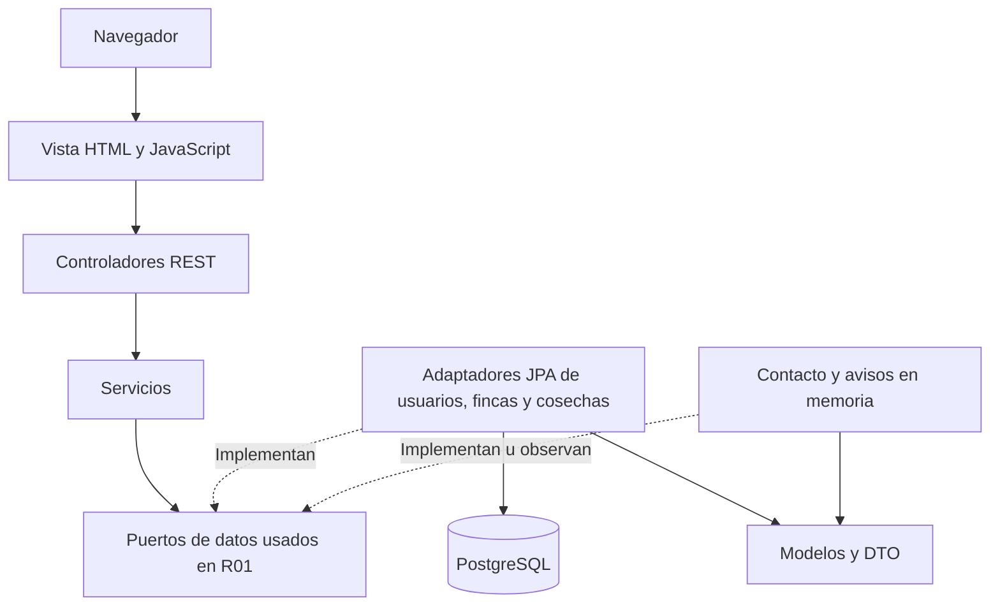

# Arquitectura y alcance técnico

Java 25 y Spring Boot 3.5.16 con Maven Wrapper 3.9.9. La clase de arranque configura
el servidor web. Los controladores reciben DTO validados y delegan las reglas a
servicios. T01 persiste las cuentas mediante JPA y PostgreSQL; T04 hace lo mismo con
las fincas. El Sprint 2 persiste categorías, productos y cosechas de HU-02. El repositorio
de contacto y los avisos de demostración todavía conservan estado en memoria. R01
introduce contratos pequeños de datos para cosechas, contacto y precios. La vista HTML
estática vive en `resources/static` y `EstadoController` expone el estado del Sprint 2.

Los paquetes separan controladores, DTO, servicios, repositorios y modelos; la vista se
sirve desde la ubicación estándar de Spring Boot. src/main/views documenta esa
decisión. La conexión de PostgreSQL usa variables de entorno para no versionar
credenciales. Las pruebas usan H2 en modo compatible con PostgreSQL.

## Decisiones
- T01 conecta PostgreSQL para usuarios, T04 persiste fincas y el Sprint 2 agrega el
  camino normalizado categoría–producto–cosecha con claves foráneas.
- T03 añade Spring Security y JWT sin sesión. La identidad de HU-08 se toma del token,
  no de un identificador enviado por el cliente. HU-02 conserva la misma regla.
- Los repositorios de cuentas, fincas, ofertas y contacto implementan puertos consumidos
  por los servicios. El Sprint 2 aplica Strategy para fletes y Observer para reaccionar
  a publicaciones confirmadas. Spring administra componentes compartidos; no se crea
  un Singleton manual.
- Mockito usa mock-maker-subclass en tests para evitar adjuntar un agente dinámico a
  la JVM. No permite simular clases finales; revisar esta elección cuando se necesiten.
- El puerto predeterminado es 8081 por el conflicto local detectado con 8080. Se puede
  cambiar con PORT o --server.port. No se termina ningún otro proceso automáticamente.

## Funcionalidades futuras
El backlog conserva contratos BDD para las 15 historias. La persistencia de cosechas y
los filtros se materializa en este incremento; la persistencia de contactos, avisos,
transacciones de compra y estados de pedido queda para futuros Sprints. El primer pedido
será de un solo agricultor. No hay pagos reales ni GPS continuo.

## Refactorización R01

`CosechaService` se ocupa de publicar y consultar ofertas. `ConsultaPreciosService`
conserva por separado el cálculo de precios del prototipo. `ContactoService` coordina
las comprobaciones y el guardado de la solicitud sin llamar a servicios concretos.
Los tres reciben sus contratos de datos por constructor. El adaptador JPA de usuarios y
los repositorios temporales restantes implementan esos contratos; Spring selecciona el
único bean disponible por contrato.

Los errores de recurso ausente y operación no permitida de esos casos se traducen a
HTTP en `ApiExceptionHandler`, manteniendo el JSON anterior. T01 hace que
`AgricultorService` dependa de `UsuarioPort` y agrega el adaptador JPA; `FincaService`
y los demás repositorios conservan todavía su almacenamiento temporal.

El detalle, las pruebas y los pendientes se documentan en [R01](refactorizacion-r01.md).

## Extensión del Sprint 2

`CosechaService` depende de `CosechaPort`, `FincaPort` y `ApplicationEventPublisher`.
El adaptador `CosechaRepository` resuelve las relaciones JPA y mantiene el dominio sin
anotaciones de persistencia. `ProductoController` obtiene `UsuarioAutenticado` desde
Spring Security; el DTO de entrada no contiene identidad de usuario.

`CalculadoraFleteService` recibe implementaciones ordenadas de `EstrategiaFlete`. El evento
`CosechaPublicadaEvent` permite que `NotificacionCosechaListener` reaccione después del
commit sin introducir una dependencia desde la publicación hacia el canal de avisos.
El detalle y sus límites se documentan en [patrones del Sprint 2](patrones-sprint2.md).
