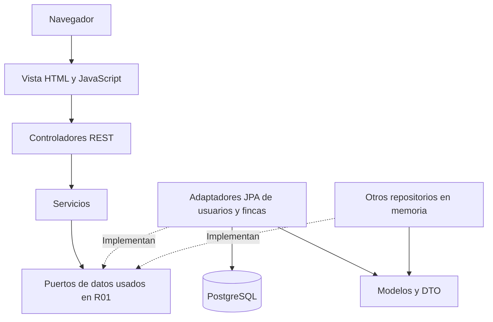

# Arquitectura y alcance técnico

Java 25 y Spring Boot 3.5.16 con Maven Wrapper 3.9.9. La clase de arranque configura
el servidor web. Los controladores reciben DTO validados y delegan las reglas a
servicios. T01 persiste las cuentas mediante JPA y PostgreSQL; T04 hace lo mismo con
las fincas. Los repositorios de cosechas y contactos conservan temporalmente el estado.
R01 introduce contratos pequeños de datos para los servicios de cosechas, contacto y precios.
La vista HTML estática vive en resources/static. EstadoController conserva el
endpoint de salud del Sprint 0.

Los paquetes separan controladores, DTO, servicios, repositorios y modelos; la vista se
sirve desde la ubicación estándar de Spring Boot. src/main/views documenta esa
decisión. La conexión de PostgreSQL usa variables de entorno para no versionar
credenciales. Las pruebas usan H2 en modo compatible con PostgreSQL.

## Decisiones
- T01 conecta PostgreSQL para usuarios y T04 persiste fincas con una clave foránea hacia
  su agricultor propietario.
- T03 añade Spring Security y JWT sin sesión. La identidad de HU-08 se toma del token,
  no de un identificador enviado por el cliente.
- Los repositorios de cuentas, fincas, ofertas y contacto implementan los cuatro puertos
  usados por R01. Factory y Observer se evaluarán cuando exista el caso de uso.
  Spring administra componentes compartidos por defecto; no se
  crea un Singleton manual ni se afirma aplicar patrones sin necesidad real.
- Mockito usa mock-maker-subclass en tests para evitar adjuntar un agente dinámico a
  la JVM. No permite simular clases finales; revisar esta elección cuando se necesiten.
- El puerto predeterminado es 8081 por el conflicto local detectado con 8080. Se puede
  cambiar con PORT o --server.port. No se termina ningún otro proceso automáticamente.

## Funcionalidades futuras
El backlog conserva contratos BDD para las 15 historias. La persistencia de cosechas y
contactos, las transacciones y los estados de pedido son requisitos de futuros Sprints.
El primer pedido será de un solo agricultor. No hay pagos reales ni GPS continuo.

## Refactorización R01

`CosechaService` se ocupa de publicar y consultar ofertas. `ConsultaPreciosService`
conserva por separado el cálculo de precios del prototipo. `ContactoService` coordina
las comprobaciones y el guardado de la solicitud sin llamar a servicios concretos.
Los tres reciben sus contratos de datos por constructor. El adaptador JPA de usuarios y
los repositorios temporales restantes implementan esos contratos; Spring selecciona el
único bean disponible por contrato.

Los errores de recurso ausente y operación no permitida de esos casos se traducen a
HTTP en `ApiExceptionHandler`, manteniendo el JSON anterior. T01 hace que
`AgricultorService` dependa de `UsuarioPort` y agrega el adaptador JPA; `FincaService`
y los demás repositorios conservan todavía su almacenamiento temporal.

El detalle, las pruebas y los pendientes se documentan en [R01](refactorizacion-r01.md).
