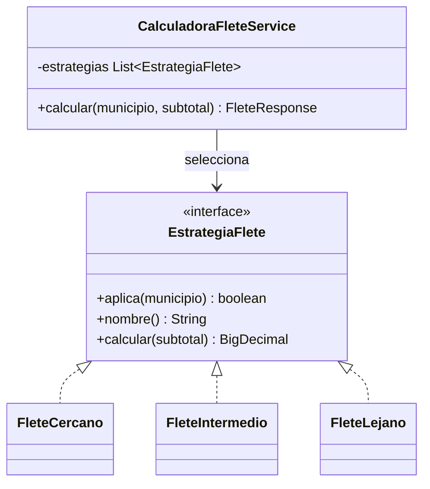
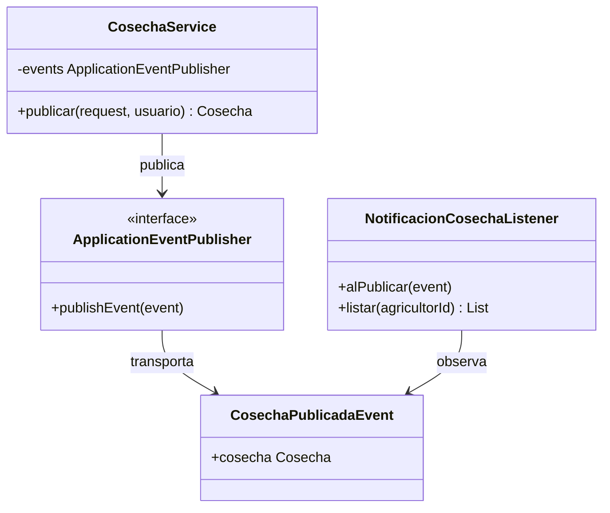

# Patrones comportamentales del Sprint 2

## Selección y problema de negocio

El Sprint 2 implementa dos patrones comportamentales en el backend. **Strategy** resuelve
la variación del cálculo de flete según el municipio del Valle del Cauca. Evita un bloque
rígido de condiciones y permite incorporar otra zona mediante una nueva estrategia.
**Observer** desacopla la publicación de una cosecha de las reacciones posteriores. El
servicio emite un evento y el receptor genera el aviso sin que el publicador conozca el
canal de notificación.

## Diagrama de clases - Strategy

`CalculadoraFleteService` recibe la colección por constructor. Spring ordena las
implementaciones para probar primero las zonas específicas y dejar `FleteLejano` como
respaldo para los demás municipios válidos.

## Diagrama de clases - Observer

El listener usa `@TransactionalEventListener(AFTER_COMMIT)`, por lo que reacciona después
de confirmar la transacción de publicación. El almacenamiento multicanal de avisos queda
fuera del alcance de HU-02 y HU-04.

## Evidencia automatizada

- `CalculadoraFleteServiceTests` verifica las tres estrategias y entradas inválidas.
- `CosechaServiceTests` verifica con Mockito el evento publicado.
- `Sprint2EndpointsTests` valida con MockMvc el cálculo y el aviso consultable.
- JaCoCo exige como mínimo 60 % en instrucciones, ramas y líneas.
- Checkstyle y el hook de pre-commit ejecutan controles antes de integrar cambios.

La trazabilidad ampliada de SOLID y de las decisiones técnicas permanece en
[`docs/patrones-sprint2.md`](../patrones-sprint2.md).
