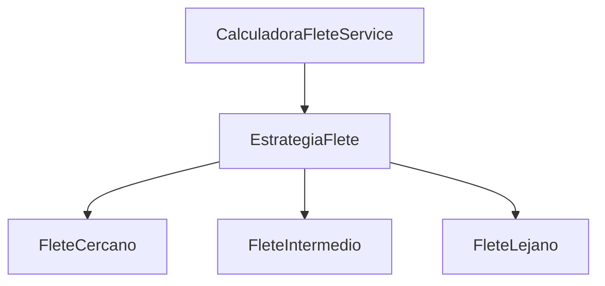
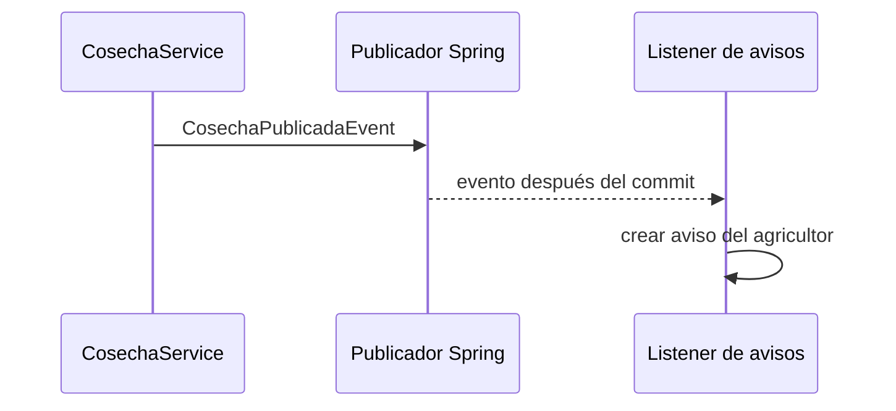

# SOLID y patrones GOF del Sprint 2

## Decisiones de diseño

El incremento aplica patrones donde existe una variación o un evento concreto. No se
agrega un Singleton manual: Spring ya administra el ciclo de vida de sus componentes y
un estado global adicional dificultaría las pruebas.

## SOLID

| Principio | Aplicación observable |
|---|---|
| SRP | `CosechaService` coordina publicación y filtros; `CalculadoraFleteService` selecciona tarifas; el listener transforma eventos en avisos; los repositorios mapean persistencia. |
| OCP | Una nueva zona de flete puede implementarse como otra `EstrategiaFlete` sin modificar los algoritmos existentes. |
| LSP | Las estrategias ofrecen el mismo contrato `aplica`, `nombre` y `calcular`; el contexto puede sustituirlas. |
| ISP | `CosechaPort` y `FincaPort` exponen operaciones pequeñas requeridas por sus casos de uso. |
| DIP | Los servicios reciben puertos y `ApplicationEventPublisher` por constructor, no construyen adaptadores JPA. |

## Strategy · cálculo de flete

`CalculadoraFleteService` actúa como contexto y recibe por constructor una lista ordenada
de `EstrategiaFlete`. Normaliza el municipio, valida el subtotal y selecciona la primera
estrategia aplicable. Los resultados se redondean a dos decimales con `HALF_UP`.

| Estrategia | Regla académica | Ejemplo sobre COP 100.000 |
|---|---|---:|
| CERCANO | COP 8.000 + 2 % | COP 10.000,00 |
| INTERMEDIO | COP 15.000 + 3 % | COP 18.000,00 |
| LEJANO | COP 22.000 + 4 % | COP 26.000,00 |

Las tarifas sirven para demostrar sustitución de algoritmos. No representan una tarifa
comercial vigente ni confirman una orden.

## Observer · publicación de cosecha

`CosechaService` publica `CosechaPublicadaEvent` sin conocer receptores. El método
`NotificacionCosechaListener.alPublicar` observa el evento después del commit y genera
un aviso para el agricultor. El publicador permanece cerrado a cambios cuando se añadan
otros observadores, como auditoría o correo.

El registro de avisos de esta demostración es concurrente pero volátil. Convertirlo en
un adaptador persistente y añadir entrega multicanal corresponde a otra historia; no se
presenta como parte terminada de HU-02 o HU-04.

## Pruebas

- `CalculadoraFleteServiceTests` recorre las tres estrategias y los datos inválidos.
- `CosechaServiceTests` verifica que el evento contiene exactamente la cosecha guardada.
- `Sprint2EndpointsTests` comprueba la respuesta del cálculo y el aviso visible por JWT.
- Mockito aísla los puertos y MockMvc cubre el contrato HTTP con seguridad y persistencia.
